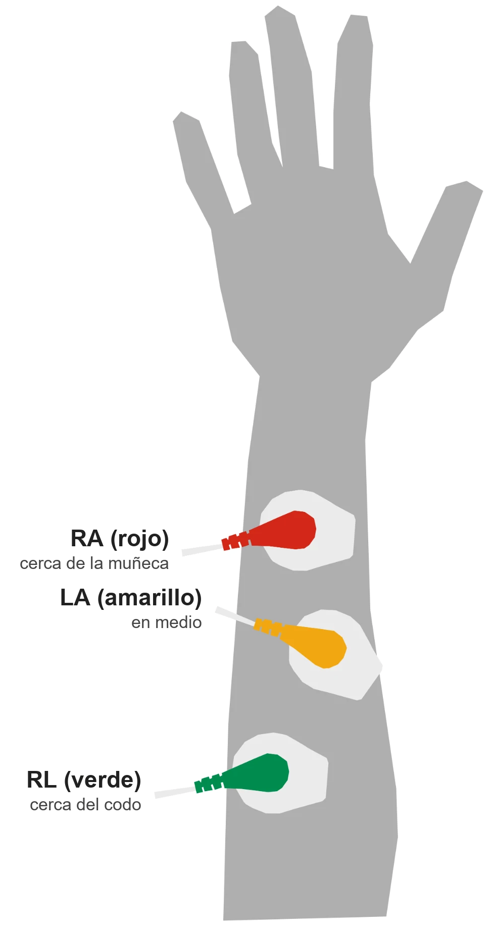

# Mano InMoov con AD8232 (ECG, 3.3 V)

## Cómo correr el programa

El archivo [Inmoov_EMG/Inmoov_EMG.ino](Inmoov_EMG/Inmoov_EMG.ino) ya contiene el firmware completo como **sketch autocontenido listo para abrir en Arduino IDE**. Al pulsar **Subir**, el IDE lo compila y lo carga al Arduino. Para usar esta versión basta con ese archivo, el IDE y el montaje descrito aquí; los scripts de regeneración y pruebas se explican en [Cómo compilar después de modificar el código](#cómo-compilar-después-de-modificar-el-código).

### Requisitos

- **Arduino UNO R3**, computadora y cable USB de datos compatible con su conector USB-B.
- **Arduino IDE** instalado, con el paquete **Arduino AVR Boards 1.8.6** y la biblioteca **Servo 1.2.2**. EEPROM viene incluida en el paquete AVR.
- El archivo **`Inmoov_EMG.ino` dentro de una carpeta llamada `Inmoov_EMG`**. Puedes usar directamente la carpeta del repositorio; el sketch también se puede copiar por sí solo a otra carpeta con ese nombre.
- **Mano InMoov ensamblada**, cinco servos **MG995**, sus poleas y tendones instalados, con el recorrido mecánico libre. Deja los tensores sueltos para la primera comprobación de sentido y extremos.
- **Módulo AD8232 de UNIT Electronics**, cable y electrodos, pulsador para D8, selector para D9 y cables de conexión.
- **Alimentación de los servos:** paquete preparado de cuatro celdas 18650 en configuración **2S2P** (dos portapilas de dos celdas en serie, conectados entre sí en paralelo; 7.4 V nominales) y **regulador a 5 V** dimensionado para los cinco servos.
- **Alimentación autónoma del Arduino:** pila cuadrada de **9 V** con adaptador al conector de alimentación del UNO. El módulo AD8232 toma **3.3 V del Arduino**.

### 1. Preparar la mano y el archivo

Con las baterías y el USB desconectados, comprueba que la mano esté ensamblada y que los dedos puedan recorrer su trayectoria sin trabarse. Identifica el servo de cada dedo antes de conectar sus señales. La primera prueba se hace con los tensores sueltos; después se ajustan a la apertura y al cierre reales del mecanismo.

Conserva los nombres `Inmoov_EMG/Inmoov_EMG.ino`. La configuración de pines y de los cinco servos ya está incluida en el archivo. Medio, anular y meñique tienen el sentido de giro invertido respecto de pulgar e índice.

### 2. Cargar el programa desde Arduino IDE

1. Instala y abre [Arduino IDE](https://www.arduino.cc/en/software). En el **Gestor de placas**, busca **Arduino AVR Boards** e instala la versión **1.8.6**.
2. En **Herramientas → Administrar bibliotecas**, busca **Servo**, de Arduino, e instala la versión **1.2.2**. No necesitas instalar EEPROM por separado. Consulta la [guía de bibliotecas del IDE](https://support.arduino.cc/hc/en-us/articles/5145457742236-Install-libraries-in-the-Arduino-IDE).
3. Mantén apagada la alimentación de los servos y los electrodos desconectados del cuerpo. Conecta el UNO a la computadora por USB y abre **`Inmoov_EMG/Inmoov_EMG.ino`**.
4. Selecciona **Arduino Uno**, del paquete AVR, y el **puerto** correspondiente a la placa, desde el selector del IDE o **Herramientas → Placa / Puerto**.
5. Pulsa **Subir** y espera la confirmación de carga terminada. El programa queda guardado en el Arduino y vuelve a ejecutarse al encenderlo. Si falla la carga, revisa placa, puerto y cable de datos según la [guía de carga de Arduino](https://support.arduino.cc/hc/en-us/articles/4733418441116-Upload-a-sketch-in-Arduino-IDE).
6. Desconecta el USB antes de realizar el cableado y pasar a la alimentación por baterías.

### 3. Conectar la alimentación, los servos y el módulo

Haz estas conexiones **sin energizar el montaje**. El regulador entrega **5 V a los servos**; la pila de **9 V alimenta al UNO por su conector de alimentación**; el pin **3.3V del UNO alimenta al AD8232**. Consulta también [alimentación y límites eléctricos](#compatibilidad-del-sensor-y-alimentación).

**Tierra común:** conecta entre sí el **negativo de la fuente de baterías de los servos**, la tierra del regulador, los **GND de los cinco servos**, un **GND del Arduino** y el **GND del AD8232**. El negativo de la pila de 9 V también queda unido a esa misma tierra a través del adaptador de alimentación del UNO. Esta conexión da una referencia común a las señales del Arduino; los positivos conservan sus conexiones separadas de 5 V, 9 V y 3.3 V.

<a id="cableado-de-señales"></a>

#### Tabla de pinout

| Componente / terminal | Conectar a | Función |
| --- | --- | --- |
| Pila de 9 V | Conector de alimentación del UNO, con adaptador de centro positivo | Alimentación del Arduino; no conectar 9 V a `5V` ni a `3.3V` |
| Paquete 18650 2S2P | Entrada del regulador de 5 V, respetando polaridad | Fuente de potencia de los servos |
| Positivo de alimentación de cada servo | Salida **+5 V del regulador** | Potencia de los cinco MG995; no usar el pin `5V` ni el USB del UNO |
| GND de cada servo y tierra de la fuente/regulador | **GND común**, unido a GND del UNO | Retorno de potencia y referencia de las señales |
| AD8232 `3.3V` | **3.3V del UNO** | Alimentación del módulo; no conectar al riel de servos |
| AD8232 `GND` | **GND común** | Referencia compartida con Arduino y servos |
| AD8232 `OUTPUT` | **A0** | Entrada analógica de la señal |
| AD8232 `LO+` | **A1** | Detección de pérdida de contacto, sin pull-up de 5 V |
| AD8232 `LO−` | **A2** | Detección de pérdida de contacto, sin pull-up de 5 V |
| AD8232 `SDN` | **3.3V del UNO** | Mantener habilitado el módulo |
| Señal del servo del pulgar | **D3** | Orden de posición del pulgar |
| Señal del servo del índice | **D5** | Orden de posición del índice |
| Señal del servo del medio | **D6** | Orden de posición, sentido invertido |
| Señal del servo del anular | **D10** | Orden de posición, sentido invertido |
| Señal del servo del meñique | **D11** | Orden de posición, sentido invertido |
| Pulsador normalmente abierto | Entre **D8 y GND** | Cada pulsación alterna cierre/apertura en manual; `INPUT_PULLUP` |
| Selector de modo | Entre **D9 y GND** | Cerrado a GND = manual; abierto = control por señal; `INPUT_PULLUP` |
| Cable de electrodos `RA` / `LA` / `RL` | Conector de electrodos del AD8232, según las marcas del módulo | Entradas de señal y referencia corporal; no son pines de alimentación |
| D7 / D12 / D13 | Sin conexión requerida | Pines libres; el montaje no usa LED RGB |
| D2 | Sin conexión requerida para uso normal | Sonda de muestreo opcional; conmuta en cada conversión ADC |
| D0 / D1 | Sin conexión externa requerida para uso normal | Diagnóstico UART por USB en la variante de depuración; no conectar servos aquí |

En cada servo distingue **señal, positivo y GND** según su conector; los tres cables cumplen funciones distintas. El orden de dedos del firmware es pulgar, índice, medio, anular y meñique. Los servos reciben energía del regulador y solo su señal va al pin digital indicado.

En el AD8232 sigue las **etiquetas impresas del módulo**, no la posición de los pines de otra tarjeta. En este proyecto `LO+` y `LO−` van a **A1/A2**: D10/D11 ya están ocupados por los servos. Conecta el cable de electrodos al módulo e identifica `RA`, `LA` y `RL` conforme a su guía; esos terminales no se unen a GND ni a la alimentación. La [figura y la tabla de colocación](#5-colocar-los-electrodos-y-usar-el-control-por-señal) indican cómo van los parches y los cables de este montaje. La función eléctrica del AD8232 se detalla en [compatibilidad del sensor](#compatibilidad-del-sensor-y-alimentación).

Antes de energizar los servos, verifica con multímetro que la salida del regulador esté ajustada a **5 V** y que la polaridad y la tierra común sean correctas. El paquete 2S2P no se conecta directamente a los servos. Para el UNO, la pila se conecta mediante el adaptador a su entrada de alimentación, como describe la [documentación del UNO R3](https://docs.arduino.cc/hardware/uno-rev3/).

### 4. Encender y comprobar el funcionamiento

1. Deja **D9 conectado a GND** para arrancar en **modo manual**, con los tensores sueltos y sin obstruir el mecanismo. Alimenta el Arduino con su pila y habilita la fuente regulada de los servos. Al iniciar, el firmware ordena apertura.
2. Pulsa el botón de **D8** una vez para cerrar y otra para abrir; mantenerlo presionado no repite la orden. Comprueba que cada señal corresponda a su dedo y que el giro de medio, anular y meñique sea el previsto. Si un dedo se traba o tira en sentido incorrecto, corta la alimentación de los servos antes de corregir el montaje.
3. Ajusta los tensores al recorrido comprobado. Los extremos de 544/2400 us son órdenes del firmware; el recorrido real depende de cada servo y del mecanismo. Si necesitas cambiar extremos o pines, sigue [Cómo compilar después de modificar el código](#cómo-compilar-después-de-modificar-el-código).
4. Cuando el modo manual funcione y los tensores estén ajustados, continúa con [la colocación de electrodos y el control por señal](#5-colocar-los-electrodos-y-usar-el-control-por-señal).

Una vez cargado, el firmware funciona al encender el Arduino; el uso normal se controla con D8/D9. La variante incluida tiene la UART deshabilitada y no requiere tener abierto el IDE, un Monitor Serie ni el analizador. Para observar la señal en la computadora, consulta [Analizador y depuración opcional](#analizador-y-depuración-opcional) y las precauciones de conexión de electrodos a USB en [alimentación](#compatibilidad-del-sensor-y-alimentación).

### 5. Colocar los electrodos y usar el control por señal

Con la mano comprobada en modo manual, mantén el **USB desconectado** y el sistema alimentado por baterías antes de colocar los electrodos en el cuerpo. La imagen muestra la colocación utilizada en este proyecto sobre el **antebrazo derecho**. El control usa fronteras fijas de **5 y 10**; repetir la postura y la posición de los parches ayuda a mantener condiciones similares de lectura.



*Figura 3. Colocación de los electrodos en el antebrazo derecho. Elaboración propia (Arroyo Onofre Leonardo), a partir de una fotografía tomada por el autor.*

| Cable | Color | Terminal del AD8232 | Posición en el antebrazo derecho |
| --- | --- | --- | --- |
| **RA** | Rojo | RA | Cerca de la muñeca |
| **LA** | Amarillo | LA | En medio |
| **RL** | Verde | RL (referencia) | Cerca del codo |

Los colores corresponden al cable de este montaje; comprueba también las marcas **RA/LA/RL** del módulo y del cable. Estos terminales se conectan a los electrodos, no a los pines de alimentación ni al GND del Arduino.

1. **Brazo y postura.** Apoya el antebrazo derecho relajado sobre una mesa, con la palma hacia arriba (cara del flexor), la mano hacia el frente y el codo hacia el cuerpo.
2. **Piel.** Limpia la zona con alcohol y deja que seque antes de pegar los parches. Si hay vello que impida el contacto, recórtalo o rasúralo para que el parche toque la piel.
3. **Posición.** Coloca los tres parches en línea a lo largo de la zona del flexor, con separación similar entre ellos, tomando aproximadamente el ancho del antebrazo como referencia: **RA rojo cerca de la muñeca, LA amarillo en medio y RL verde cerca del codo**, como en la figura.
4. **Pegado.** Retira el plástico protector, pega cada parche sin arrugas y presiona unos segundos, especialmente los bordes, para evitar burbujas de aire.
5. **Conexión.** Encaja cada cable en el botón de su parche siguiendo la tabla. Enchufa el cable de electrodos al AD8232 y deja los cables con holgura, sin que tiren de los parches al mover el brazo.
6. **Activación.** Abre el selector de **D9** para pasar al modo por señal; el cambio de modo solicita apertura. Espera aproximadamente **2 s de señal válida** y un primer bloque nuevo de **200 muestras (~200 ms)** antes de apretar el puño. FW8 comienza automáticamente, sin calibración.
7. **Pérdida de contacto.** Si `LO+` o `LO−` indican un electrodo desconectado, el firmware solicita apertura. Revisa la adhesión, los botones y el cableado. Al recuperarse la señal, espera otra vez los **2 s de señal válida** y las **200 muestras nuevas** antes de continuar.

**Parches nuevos en cada uso.** Usa parches nuevos cada vez que coloques el sensor. Un parche usado pierde adhesión y puede secarse; al reutilizarlo puede despegarse o hacer mal contacto, produciendo lecturas incorrectas y pérdidas de señal. Al terminar, apaga el montaje, retira los parches despacio y deséchalos.

El programa ordena apertura, posición intermedia o cierre a partir del promedio de actividad. El AD8232 sigue en evaluación física: una carga correcta y el funcionamiento manual no garantizan una clasificación estable de contracciones.

## Proyecto y estado de FW8

Adaptación de `Inmoov_Robot_Hand.ino` de Kuldip.K Gami al proyecto de Fundamentos de Sistemas Embebidos. Los archivos originales `.ino` y `Robotic Hand.txt` contienen el mismo programa. Se retiraron `SoftwareSerial`, los comandos Bluetooth y los movimientos con `delay()`.

La implementación conserva la plataforma y los pines de actuadores del proyecto: Arduino UNO R3, ATmega328P a 16 MHz y cinco servos. El sensor del proyecto ahora es el **AD8232 de UNIT Electronics**. Se añaden A1 y A2 para detectar pérdida de contacto. Un solo canal de actividad abre/cierra la mano completa; no identifica dedos individuales.

La conexión de alimentación de un EMG genérico al riel de 5 V **no corresponde a este AD8232**.

Versión del repositorio: **v1.0.1**, registrada en [VERSION](VERSION), sobre la rama `main`. El firmware mantiene **FW8**, con control fijo por tres niveles y sin calibración. `v1.0.0` conserva el cierre de FW8; `v1.0.1` incorpora las precisiones posteriores de alimentación y documentación. [Control por promedios](docs/control-senal.md) · [Datos sintéticos de prueba](tests/datos/README.md).

Las capturas reales del AD8232 ya no se versionan porque contienen datos biométricos/de salud: el ECG puede identificar a la persona y este repositorio es público. Sus resultados se resumen en el informe del Avance 4. Se retiraron del árbol actual; las revisiones anteriores aún las contienen. La reconstrucción local de autoría conserva esos archivos históricos y sus bytes. El analizador guarda las sesiones nuevas fuera del repo, en `Path.home() / "registros-emg"`, con identificador aleatorio.

El analizador solicita consentimiento y contraseña por sesión, cifra los registros con AES-256-GCM y verifica su integridad con HMAC-SHA256. No guarda contraseñas, omite la hora absoluta por defecto y no exporta PNG automáticamente. Consulta [instalación, formato, verificación, descifrado y conservación](Inmoov_EMG/analizador_senal/README.md). No publiques registros ni contraseñas.

## Estado actual del sensor

El módulo AD8232 presenta una señal muy variable y todavía se investiga la causa. Entre las hipótesis están una soldadura deficiente, un módulo deteriorado, jumpers o conectores con mal contacto, alimentación/referencia inestable y condiciones de los electrodos. Ninguna se ha confirmado. El filtrado y las pruebas automatizadas no demuestran que el problema físico esté resuelto. Consulta [el diagnóstico y las comprobaciones pendientes](docs/diagnostico-sensor.md).

## Código modular

[`Inmoov_EMG/Inmoov_EMG.ino`](Inmoov_EMG/Inmoov_EMG.ino) es el único sketch generado del firmware y contiene el programa completo, incluida la configuración de los servos, para abrirlo directamente en Arduino IDE. Se genera desde los módulos `.h` y `.cpp` con `python scripts/export_ino.py`; edita esos módulos y regenera el sketch para conservar los cambios. Los `.cpp` se compilan por separado solo en las pruebas nativas para evitar definiciones duplicadas en Arduino.
Los comentarios `D01` a `D06` enlazan decisiones concretas con [la bitácora técnica](docs/bitacora.md).

| Módulo | Responsabilidad |
| --- | --- |
| `Config.h` | Pines, tiempos, límites y direcciones del contador EEPROM con nombre |
| `Acquisition.h/.cpp` | Timer2/ADC, ISR breve, cola circular y secciones atómicas |
| `SampleQueue.h` | Comunicación SPSC de muestras completas con marca de tiempo |
| `Signal.h` | Salud, centrado DC, rectificación y media Q6 |
| `SignalFilter.h` | HP30, rechazo de 60 Hz y LP200 a 1 kHz, fuera de ISR |
| `Decision.h` | Promedio de 200 muestras de envolvente y control fijo por tres niveles |
| `Motion.h` | Rampa simultánea y conversión a pulsos |
| `Inputs.h` | Antirrebote de botón y selector |
| `Outputs.h/.cpp` | GPIO y cinco servos; deshace un arranque parcial |
| `Storage.h/.cpp` | Contador de arranque EEPROM con lectura de verificación |
| `Diagnostics.h/.cpp` | Comandos y telemetría UART de baja prioridad |
| `Application.h/.cpp` | Coordinación de módulos y recuperación de fallas |
| `tests/`, `scripts/` | Pruebas con fallas inducidas y compilación reproducible |

[Diagrama conectado](docs/arquitectura.md) · [Matriz de requisitos](docs/requisitos.md) · [Resultados esperados y obtenidos](docs/resultados-pruebas.md) · [Protocolo físico](docs/pruebas-hardware.md).

## Compatibilidad del sensor y alimentación

**Alimenta el módulo AD8232 a 3.3 V; nunca directamente desde el paquete de baterías ni desde el riel de servos de 5 V.** Conecta su `GND` a la tierra común y `OUTPUT` a A0. Su rango nominal de salida queda dentro de 0–3.3 V. El UNO conserva AVcc, nominalmente 5 V, como referencia ADC: la salida ocupará aproximadamente 0–675 cuentas de sus 10 bits. No hace falta conectar AREF a 3.3 V.

`LO+` y `LO−` se conectan a A1/A2 como **entradas sin pull-up de 5 V**. Un nivel alto en cualquiera inhibe el control por señal. `SDN` se puede mantener a 3.3 V para habilitar el módulo; no se maneja con una salida de 5 V del UNO. Los terminales RA/LA/RL corresponden a los cables de electrodos, no a alimentación ni GND.

**El AD8232 es un acondicionador ECG, no un sensor que entregue una envolvente EMG.** El [fabricante Analog Devices](https://www.analog.com/en/products/ad8232.html) explica que su banda y ganancia dependen de componentes externos. No se conoce el esquema ni la banda exacta de esta tarjeta UNIT; no se atribuyen a ella los valores de otros módulos. El control de contracciones con esta tarjeta es **experimental**: el firmware calcula una medida de actividad, pero no distingue actividad muscular voluntaria de ECG o artefactos de movimiento. El software no recupera frecuencias eliminadas por el filtro analógico. La separación entre reposo y contracción requiere validación física; FW8 usa fronteras fijas, sin calibración.

Referencias eléctricas: [ficha AD8232, revisión D](https://www.analog.com/media/en/technical-documentation/data-sheets/ad8232.pdf) y [guía de conexión de SparkFun](https://learn.sparkfun.com/tutorials/ad8232-heart-rate-monitor-hookup-guide/). La ficha del circuito integrado no sustituye el esquema de la tarjeta UNIT.

La alimentación final usa **4 celdas 18650 para los servos MG995 (dos portapilas de dos celdas en serie (7.4 V nominales cada uno), conectados entre sí en paralelo: 7.4 V nominales y el doble de capacidad, con un regulador a 5 V) y una pila cuadrada de 9 V para el Arduino**; la LiPo 3S propuesta no se consiguió. Con la fuente anterior, de 5 V fijos, se midieron con multímetro 0.1 a 0.5 A (6 y 13 de noviembre de 2026) y los servos no se movían, tardaban o no giraban completo; además el módulo se quedaba sin alimentación, por eso el Arduino va aparte. Alimenta los servos desde el regulador, dimensionado para sus corrientes, con GND común (también unido a la pila de 9 V); no desde el pin 5V ni el USB del Arduino. Corriente, regulación y autonomía siguen pendientes de validación en el montaje. Con electrodos en el cuerpo, usa alimentación por batería sin conexiones a la red, o aislamiento apropiado para la interfaz de depuración e instrumentos. La [guía del fabricante MyoWare](https://cdn.sparkfun.com/assets/learn_tutorials/1/9/5/6/MyoWare_v2_QuickStartGuide.pdf) explica esta precaución para sistemas de electrodos conectados a USB.

<a id="carga-y-primera-prueba"></a>

## Analizador y depuración opcional

La compilación predeterminada es **normal**, con `EMG_SERIAL_DEBUG=0`: no inicia, lee ni emite por UART. La UART del UNO no ofrece cifrado ni autenticación; la variante de uso normal evita transmitir datos de señal y estado.

Para usar el analizador, carga la variante **depuracion** según [Cómo compilar después de modificar el código](#cómo-compilar-después-de-modificar-el-código), cambiando `--input-dir` a `build/depuracion`. En Arduino IDE puedes añadir `#define EMG_SERIAL_DEBUG 1` al principio del `.ino`, antes de la sección `Config.h`, y subirlo; la regeneración elimina esa edición local. Con CLI se habilita mediante `-DEMG_SERIAL_DEBUG=1`, que `build.py` aplica a esa variante. Para volver al uso normal, carga `build/normal` o elimina el define del IDE y vuelve a subir.

Solo en depuración, abre el Monitor Serie a **115200 baudios** y envía `?` para identificar el firmware. Debe aparecer `E,...,SERVO_REVERSE_MASK,28`: indica que medio, anular y meñique están invertidos. Cierra el monitor antes de abrir el analizador. El flujo periódico arranca apagado y se activa con `p`; el analizador lo envía automáticamente si no recibe flujo inicial. Los eventos puntuales de arranque, fallas y consultas pueden emitirse sin `p`. Si el movimiento físico no corresponde, comprueba que sus señales estén en D6, D10 y D11.

Los pulsos de 544/2400 us representan **0°/180° ordenados**, sin garantizar esos ángulos físicos. El ángulo real depende del servo, polea y tensores; debe medirse y ajustarse mecánicamente como indica R3. Se usan `writeMicroseconds()` y límites por dedo para no confundir grados con ancho de pulso.

## Control de mano por tres niveles

FW8 promedia bloques de 200 muestras de envolvente (~200 ms) y ordena a los cinco dedos: promedio menor que 5 -> 0°, de 5 a menos de 10 -> 90°, desde 10 -> 180°. No requiere calibración ni utiliza sus umbrales anteriores de EEPROM. Los promedios fraccionarios se clasifican sin redondear hacia arriba.

Se abandonó la calibración porque solía fallar al mezclarse la señal con los latidos. La tercera señal del analizador (envolvente) ofreció la referencia elegida por el equipo: 1–4 en reposo, 5–9 con tensión media y ≥10 con la mano tensada. Promediar 200 muestras introduce ~200 ms por bloque: **R1 (latencia ≤50 ms) no se cumple por diseño**. Estas observaciones previas motivan el método; no son nuevas mediciones de este paso. Consulta [la decisión en la bitácora](docs/bitacora.md#retiro-de-calibración-y-control-ponderado-en-fw8).

La rampa usa 544/1472/2400 us para los objetivos 0°/90°/180° en pulgar e índice, y 2400/1472/544 us en medio, anular y meñique (0° → 180°, 90° → 90°, 180° → 0°). Una señal inválida vacía el promedio y abre en modo EMG. El ángulo real debe verificarse en el montaje. Consulta [el funcionamiento](docs/control-senal.md).

En el analizador, Iniciar graba y Detener termina el registro. Pausar / abrir (`x`) pausa el control y solicita apertura. Activar control (`c`) lo reactiva, sin calibrar. La pantalla muestra media y destino. D9/D8 conservan modo manual. La variabilidad física sigue en investigación.

En la variante de depuración, las fallas se reportan por UART a 115200 baudios mediante eventos `E,...`, incluidos `SIGNAL_FAULT`, `SERVO_INIT_FAILED`, `SERVO_WRITE_FAILED`, `ADC_INIT_FAILED` y `EEPROM_BOOT_FAILED`.

## Temporización y diagnóstico

- **Timer2:** CTC, prescaler 64, OCR2A=249; solicita una conversión cada 1 ms. Si el ADC sigue ocupado o su resultado no fue recogido, registra pérdida.
- **ADC:** A0/AVcc, prescaler 128, reloj ADC de 125 kHz. La ISR publica ADC, LO+/LO− y `millis()` en una cola circular estática de 32 posiciones (31 útiles). La primera conversión tiene timeout de 1000 us; se comprueba la configuración por lectura de registros.
- **Sincronización:** productor ISR y consumidor `loop`; extracción y alarmas protegidas con `ATOMIC_RESTORESTATE`. `volatile` da visibilidad, la sección crítica da atomicidad. No existen procesos ni hilos de SO en este diseño bare-metal.
- **Procesamiento en el bucle:** Signal centra, SignalFilter aplica HP30/notch60/LP200 y Signal rectifica/promedia 32 muestras con precisión Q6. Cada muestra se procesa una sola vez, hasta 31 por vuelta. Las ISR no filtran ni escriben UART/EEPROM.
- **Timer1:** reservado a Servo para cinco trenes de pulsos de aproximadamente 50 Hz. Timer0 conserva `millis()`/`micros()`. Las ISR AVR no se anidan ni tienen prioridades de RTOS configurables; véase la diferencia entre prioridad relativa y orden de vectores en la bitácora.
- **Movimiento:** avance de 25/1000 cada 20 ms y primer paso inmediato: 780 ms en la simulación con bucle de 1 ms. La duración real requiere video; la rampa no recupera pasos atrasados de golpe.
- **Interfaz:** muestreo cada 5 ms y antirrebote de 10 ms. Máximo observado de 14 ms en las cinco fases del ensayo de botón con bucle simulado de 1 ms; no garantiza la latencia eléctrica del montaje.
- **Prioridades del bucle:** seguridad/muestras, UI/comandos, rampa y telemetría. Trabajo acotado; UART descarta sin esperar espacio. No hay tarea de LED RGB.
- **D2:** un flanco por conversión: 1 ms entre flancos, onda completa de 500 Hz. `EMG_SAMPLE_PROBE=0` libera D2.
- **EEPROM:** solo se conserva el contador de arranque verificado, escrito antes de habilitar el ADC. Se retiraron las utilidades de calibración y su guardado; los bytes de umbrales antiguos se ignoran.

No uses `tone()`, `analogRead()` ni reconfigures Timer1/Timer2 mientras este firmware esté activo. No se usa `analogWrite()` para los servos; Servo genera sus señales por interrupciones incluso en los pines no marcados como PWM.

Monitor serie a **115200 baud**, solo con la variante de depuración:

- `c`: reanudar el control fijo y comenzar un bloque nuevo de 200 muestras válidas, sin calibración.
- `?`: consultar versión, banda, fronteras fijas, estado del control e inversión de servos.
- `p`: activar/desactivar datos de diagnóstico a 10 Hz, apagados al arrancar, y eventos auxiliares periódicos.
- `x`: pausar el control y ordenar apertura. No sustituye al interruptor físico de alimentación.

Eventos: `E,milisegundos,nombre,valor`. `FW=8`, `FIXED_CONTROL=1`, `AVERAGE_SAMPLES=200`, `LEVEL_MID=5` y `LEVEL_HIGH=10` describen el modo fijo. `MEAN_X10` informa el promedio en décimas, `TARGET_DEG` el destino 0/90/180 y `CONTROL_PAUSED` la pausa. Son órdenes, no movimiento físico medido.

Datos: `D,milisegundos,ADC_crudo,base_DC,envolvente,umbral_abrir,umbral_cerrar,estado,overruns,logs_descartados`. `estado` combina bits: 1 = LO+/LO− alto; 2 = recorte/rango inválido; 4 = procesamiento aún no listo; 8 = ADC sin muestras recientes; 16 = pérdida de datos sin recuperación completa; 32 = falla de inicialización ADC o de salida a servos. Pueden sumarse varios bits. `estado=0` solo indica que estos controles de señal pasan; no certifica que la actividad sea una contracción voluntaria.

Los datos a 10 Hz sirven para ver niveles y estados, no para reconstruir la forma de onda ECG. Los overruns cuentan pérdidas detectadas por ADC ocupado/pendiente o cola llena; el contador satura en 65535. No cuentan muestras omitidas si Timer2 deja de funcionar. La UART descarta líneas si no hay espacio para evitar bloquear el control; en una prueba de registro, verifica que no se descarten líneas. El analizador requiere la variante de depuración; el firmware normal conserva el control fijo autónomo y el modo manual con D9/D8, sin comandos UART.

Un LO alto, falta de muestras o hueco de adquisición de más de 10 ms, cola desbordada o recorte ordenan apertura en modo de señal. Una muestra cuya edad supera 10 ms se descarta: leer datos viejos no renueva la salud del sensor. Por defecto se considera recorte `raw <= 5` o `raw >= 669`, calculado para sensor de 3.3 V y AVcc=5 V. `ADC_REFERENCE_MV`, `SENSOR_SUPPLY_MV` y márgenes están en `Config.h`; si se ajustan según mediciones, regenera y recompila. El recorte, el hueco de adquisición o la pérdida de datos invalidan la ventana y exigen otras 2000 muestras estables (~2 s). Tras recuperarse, el control EMG necesita un bloque nuevo de 200 muestras válidas; no requiere recalibrar ni pasar por reposo. La apertura conserva la rampa del mecanismo; no es una desconexión de potencia.

LO+/LO− dependen de la configuración física de detección del módulo. No garantizan detectar un cable de OUTPUT roto, la desconexión de la referencia RL o todos los casos de mal contacto; tampoco detectan un dedo bloqueado. F1 sigue requiriendo ensayos reales.

## Archivos de apoyo para hardware

Estos sketches independientes se conservan tal como estaban en el directorio del proyecto y ahora estan versionados. Sirven para revisar cada componente antes de integrarlo; cada uno reemplaza temporalmente al programa principal en la placa.

| Apoyo | Para que se usa | Instrucciones |
| --- | --- | --- |
| `Prueba_Servo_Serial/Prueba_Servo_Serial.ino` | Enviar angulos 0..180 a un servo en D3, 9600 baudios; posicion inicial 90 grados | [Conexion y uso](Prueba_Servo_Serial/README.md) |
| `Prueba_AD8232_Serial/Prueba_AD8232_Serial.ino` | Observar ADC crudo y LO+/LO- por Monitor Serie/Plotter, 115200 baudios; 500 Hz nominales | [Lecturas y escala](Prueba_AD8232_Serial/README.md) |

Ambos compilan para UNO. Las confirmaciones del servo y las lecturas del ADC son herramientas de diagnostico; los resultados fisicos deben registrarse durante el ensayo. Las pruebas automatizadas de `tests/` verifican logica con datos sinteticos y cumplen otra funcion.

## Cómo compilar después de modificar el código

Esta sección sirve para **cambiar el firmware y generar una nueva versión del sketch o de los binarios**, por ejemplo al ajustar pines, extremos de servos, filtros o niveles de control. El archivo `.ino` ya incluido permite [cargar y usar la versión existente con Arduino IDE](#cómo-correr-el-programa).

Los módulos `.h` y `.cpp` de `Inmoov_EMG/` son la fuente para mantener los cambios. Edita esos módulos, por ejemplo `Config.h` para pines y extremos, y regenera `Inmoov_EMG.ino`; una regeneración reemplaza las ediciones hechas directamente en el `.ino`.

Para el flujo de scripts necesitas el repositorio completo, **Python 3.10+**, pip, **Arduino CLI 1.1.1** en PATH y un compilador C++ (g++, clang++ o Visual Studio C++ con Windows SDK). La interfaz gráfica del analizador también requiere Tk. Ejecuta los comandos desde la raíz del repositorio.

1. **Instala las dependencias.** En Bash: `bash scripts/bootstrap.sh` (usa `python3`; puedes seleccionar otro intérprete con `PYTHON`). En PowerShell:

   ```powershell
   arduino-cli core update-index
   if ($LASTEXITCODE -ne 0) { throw "No se pudo actualizar el indice" }
   arduino-cli core install arduino:avr@1.8.6
   if ($LASTEXITCODE -ne 0) { throw "No se pudo instalar AVR" }
   arduino-cli lib install Servo@1.2.2
   if ($LASTEXITCODE -ne 0) { throw "No se pudo instalar Servo" }
   python -m pip install -r Inmoov_EMG/analizador_senal/requirements.txt
   if ($LASTEXITCODE -ne 0) { throw "No se pudieron instalar las dependencias Python" }
   ```

2. **Modifica los módulos y regenera el sketch autocontenido:**

   ```powershell
   python scripts/export_ino.py
   ```

   Esto actualiza `Inmoov_EMG/Inmoov_EMG.ino`. Puedes abrirlo en Arduino IDE y cargarlo como indica [Cómo correr el programa](#cómo-correr-el-programa).

3. **Ejecuta las pruebas**, guardando el informe en `build/` para conservar el informe histórico:

   ```powershell
   python scripts/test.py --report build/resultados-pruebas.md
   ```

   Debe terminar con código 0. Si faltan `pyserial` o `cryptography`, avisa al inicio e indica cómo instalarlos; `--native-only` omite las pruebas Python y esa comprobación.

4. **Compila los binarios para Arduino Uno por CLI:**

   ```powershell
   python scripts/build.py
   ```

   El script vuelve a regenerar el `.ino`, compila las variantes `normal` (sin UART) y `depuracion` (para el analizador) y deja los binarios y logs en `build/normal` y `build/depuracion`. Debe terminar con código 0. No carga la placa.

5. **Si eliges cargar los binarios por CLI**, conecta el UNO por USB con los electrodos desconectados del cuerpo y la alimentación de servos apagada. Sustituye COM3 por el puerto real:

   ```powershell
   arduino-cli upload --fqbn arduino:avr:uno --port COM3 --input-dir build/normal Inmoov_EMG
   if ($LASTEXITCODE -ne 0) { throw "No se pudo cargar el firmware" }
   ```

   Para el analizador usa `--input-dir build/depuracion`. Si `build.py` generó `build/arduino-local.yaml`, añade `--config-file build/arduino-local.yaml` a `upload`; con una configuración propia, usa el mismo YAML que al compilar. Después de cargar, vuelve al [procedimiento de conexión y prueba](#cómo-correr-el-programa).

### Configuración y verificación reproducibles

Dependencias fijadas: Arduino CLI 1.1.1, Arduino AVR Boards **1.8.6**, Servo **1.2.2**, EEPROM **2.0** incluida en AVR; dependencias Python en [requirements.txt](Inmoov_EMG/analizador_senal/requirements.txt). Firmware Arduino C++11; pruebas nativas C++14. Se conservan Arduino y Servo, por lo que no se presenta como C puro. Los comandos de instalación, pruebas, compilación y carga por CLI están en [Cómo compilar después de modificar el código](#cómo-compilar-después-de-modificar-el-código).

`build.py` busca CLI en PATH o en Arduino IDE de Windows, comprueba AVR/Servo y selecciona explícitamente la biblioteca. Antes de compilar, regenera el único sketch de firmware, `Inmoov_EMG/Inmoov_EMG.ino`. `--variant normal` o `--variant depuracion` selecciona solo una variante; `--no-debug` es alias de la normal. `--no-probe` desactiva D2 y añade `-sin-sonda` a la carpeta y al log (por ejemplo, `python scripts/build.py --variant normal --no-probe`). Acepta `--cli RUTA`, `--config RUTA_YAML` y `--servo-library CARPETA_SERVO` para otras instalaciones. No descarga ni carga firmware. Los scripts propagan errores y generan logs en `build/` (ignorado por Git).

Memoria obtenida al ejecutar `python scripts/build.py` el **2026-11-21**, para UNO con AVR 1.8.6, Servo 1.2.2 y sonda D2 habilitada (opción predeterminada):

| Variante | Flash usada / disponible | SRAM global usada / total | SRAM restante para pila y temporales |
| --- | --- | --- | --- |
| `normal` (UART deshabilitada) | 7128 / 32256 B (22 %) | 508 / 2048 B (24 %) | 1540 B |
| `depuracion` (UART habilitada) | 11404 / 32256 B (35 %) | 1002 / 2048 B (48 %) | 1046 B |

Son cifras del compilador, conservadas en `build/normal.txt` y `build/depuracion.txt`; el margen restante no mide el máximo uso de pila en ejecución.

`test.py` descubre el entorno de MSVC automáticamente. Prueba el driver UART con `EMG_SERIAL_DEBUG=1` y comprueba por separado que la configuración normal no inicia, lee ni escribe UART. Por defecto regenera `docs/resultados-pruebas.md`; para comprobar el proyecto sin modificar el informe histórico, usa `--report build/resultados-pruebas.md`. `--native-only` omite el analizador Python. REPLAY-30S, PC-DATOS y EVIDENCIA usan exclusivamente el [dato sintético y su manifiesto](tests/datos/README.md); no validan señales físicas.

Para cargar la variante que necesita el analizador, usa `--input-dir build/depuracion` en el comando de carga de [Cómo compilar después de modificar el código](#cómo-compilar-después-de-modificar-el-código). Después de cargar, cada encendido ejecuta `setup()` automáticamente; no se espera conexión USB ni se requiere servicio Linux. Ambas variantes ejecutan FW8 sin calibración y conservan el modo manual con D9/D8.

Resultados y límites de validación están en [la tabla de pruebas](docs/resultados-pruebas.md) y [la matriz de requisitos](docs/requisitos.md). No se cargó firmware en una placa ni se accionaron motores durante esta modificación. El movimiento, PWM, consumo, exactitud muscular, autonomía y estabilidad eléctrica requieren ensayos físicos.

## Historial de versiones

Autor y committer de los commits del proyecto: **Leonardo Arroyo Onofre** (`arroyoonofrel@gmail.com`). Las etiquetas anotadas usan la misma identidad. Se conservan las atribuciones del código de origen.

La base modular recibida se conserva con la etiqueta `v0.5.0`. Los cambios posteriores se separan en mediciones, filtro, señal, calibración, decisión, telemetría, integridad de evidencia y consolidación de `v0.6.0`. Las etiquetas y fechas se detallan en [versiones](docs/versiones.md). Las capturas y sus hashes pertenecen al historial anterior; ya no se versionan datos biométricos en el árbol actual. Sus resultados se resumen en el informe del Avance 4.
