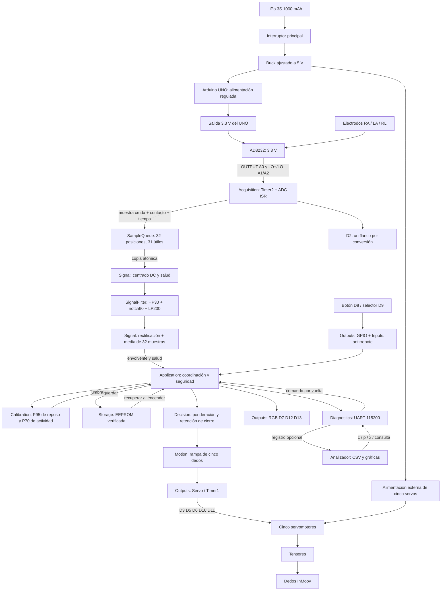

# Arquitectura y flujo de extremo a extremo

La plataforma sigue siendo Arduino UNO R3 a 16 MHz, sin SO. Cada bloque del sistema tiene una conexión en este diagrama. Las conexiones físicas se describen en el README; el diagrama representa el montaje previsto y el firmware implementado, no una certificación de ensamblaje.

Todos los circuitos de alimentación y señal comparten GND según el cableado. El AD8232 recibe 3.3 V; la alimentación de servos debe soportar sus corrientes sin pasar por USB ni el regulador del UNO. No se debe alimentar el AD8232 a 5 V.

## Propiedad de datos y sincronización

`Application` posee los estados de modo, calibración, filtro, rampa y antirrebote. Solo `loop()` los modifica. La ISR ADC posee el extremo productor de la cola; el bucle posee el consumidor. Timer2 y ADC modifican la alarma y el contador de pérdida. No hay asignaciones dinámicas en el firmware del proyecto.

La publicación de una muestra ocurre después de copiar sus campos. `Acquisition::take()` copia la muestra y avanza el consumidor dentro de `ATOMIC_BLOCK(ATOMIC_RESTORESTATE)`; lo mismo se hace con la lectura/limpieza de alarmas y el contador de 16 bits. Así se evita leer una marca de tiempo o dato de varios bytes a mitad de actualización en el AVR de 8 bits. Las pruebas FIFO verifican orden y límites; la compilación AVR incluye las secciones críticas reales. Falta medir su duración y el jitter en placa.

La cola llena rechaza la muestra nueva y registra una alarma. Al recibirla, `Application` descarta pendientes, invalida el filtro y ordena apertura en EMG. Una muestra vieja (>10 ms) tampoco puede renovar la salud. La adquisición se recupera con 2000 muestras sanas y reposo antes del cierre; una calibración interrumpida debe repetirse. La apertura es una rampa, no un corte de potencia.

## Secuencia de arranque

1. Arduino llama a `setup()` tras alimentación/reset y ejecución del bootloader.
2. Se configuran GPIO y servos abiertos; se valida `attach` y se deshace un arranque parcial si falla.
3. Se recuperan umbrales y se escribe/verifica el contador de arranque antes de habilitar ADC.
4. Se configura ADC con espera acotada y Timer2 con comprobación de registros.
5. Se entra al bucle sin esperar USB. Con calibración válida opera tras estabilización y reposo. Sin ella permanece abierto hasta una solicitud explícita; D8 permite calibrar incluso con UART deshabilitada.

Un fallo al iniciar ADC mantiene EMG inhibido hasta reiniciar; manual sigue disponible si los servos iniciaron. Un fallo de servos inhibe sus órdenes y se señala en RGB/UART. Una falla persistente de hardware no puede repararse por software.

## Contrato del filtro y de los dos relojes

SignalFilter tiene estado propio y operaciones `addQ6`/`clear`; no conoce GPIO, servos, EEPROM ni UART. Signal lo reinicia tras pérdida de salud. Sus coeficientes están diseñados para 1000 Hz; la compilación impide cambiar esa frecuencia sin revisar el filtro. El consumidor procesa todas las muestras aceptadas, manteniendo la ISR breve.

Calibration y Decision avanzan con el tiempo de adquisición. Motion avanza con el reloj del bucle y nunca recupera pasos en ráfaga. IPC-TIME verifica ponderación idéntica con una muestra o lotes de cinco. La retención normal no bloquea la vía de falla que solicita apertura. No se añadieron estados por dedo ni se modificó la persistencia incremental.
