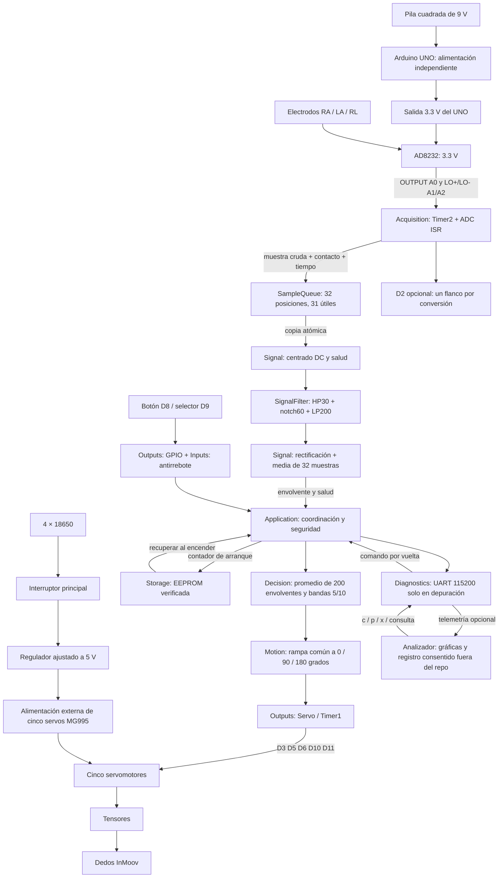

# Arquitectura y flujo de extremo a extremo

La plataforma de FW8 es Arduino UNO R3 a 16 MHz, sin SO. El control fijo por tres niveles no requiere calibración. Las conexiones físicas se describen en el README; el diagrama representa el montaje previsto y el firmware implementado, no una certificación de ensamblaje.

Todos los circuitos de alimentación y señal comparten GND según el cableado. El AD8232 recibe 3.3 V; la alimentación de servos debe soportar sus corrientes sin pasar por USB ni el regulador del UNO. No se debe alimentar el AD8232 a 5 V.

D7/D12/D13 quedan libres, sin asignación en el firmware. No hay LED RGB en el montaje ni tarea de LED. La variante `normal` no inicia, lee ni escribe UART; `depuracion` habilita el enlace y sus comandos, con telemetría periódica apagada hasta `p`. Las capturas reales del AD8232 son datos biométricos/de salud: no se versionan; el analizador guarda fuera del repositorio con consentimiento y cifrado por defecto.

## Propiedad de datos y sincronización

`Application` posee los estados de modo, pausa, promedio, filtro, rampa y antirrebote. Solo `loop()` los modifica. La ISR ADC posee el extremo productor de la cola; el bucle posee el consumidor. Timer2 y ADC modifican la alarma y el contador de pérdida. No hay asignaciones dinámicas en el firmware del proyecto.

La publicación de una muestra ocurre después de copiar sus campos. `Acquisition::take()` copia la muestra y avanza el consumidor dentro de `ATOMIC_BLOCK(ATOMIC_RESTORESTATE)`; lo mismo se hace con la lectura/limpieza de alarmas y el contador de 16 bits. Así se evita leer una marca de tiempo o dato de varios bytes a mitad de actualización en el AVR de 8 bits. Las pruebas FIFO verifican orden y límites; la compilación AVR incluye las secciones críticas reales. Falta medir su duración y el jitter en placa.

La cola llena rechaza la muestra nueva y registra una alarma. Al recibirla, `Application` descarta pendientes, invalida el filtro y ordena apertura en EMG. Una muestra vieja (>10 ms) tampoco puede renovar la salud. La adquisición se recupera con 2000 muestras sanas y un bloque nuevo de 200 envolventes; no requiere calibración. La apertura es una rampa, no un corte de potencia.

## Secuencia de arranque

1. Arduino llama a `setup()` tras alimentación/reset y ejecución del bootloader.
2. Se configuran GPIO y servos abiertos; se valida `attach` y se deshace un arranque parcial si falla.
3. Se ignoran los umbrales anteriores y se escribe/verifica el contador de arranque antes de habilitar ADC.
4. Se configura ADC con espera acotada y Timer2 con comprobación de registros.
5. Se entra al bucle sin esperar USB. El control fijo opera tras estabilización y un promedio completo, sin calibración.

Un fallo al iniciar ADC mantiene EMG inhibido hasta reiniciar; manual sigue disponible si los servos iniciaron. Un fallo de servos inhibe sus órdenes. En depuración, las fallas se reportan por UART con eventos `E,...`. Una falla persistente de hardware no puede repararse por software.

## Contrato del filtro y de los dos relojes

SignalFilter tiene estado propio y operaciones `addQ6`/`clear`; no conoce GPIO, servos, EEPROM ni UART. Signal lo reinicia tras pérdida de salud. Sus coeficientes están diseñados para 1000 Hz; la compilación impide cambiar esa frecuencia sin revisar el filtro. El consumidor procesa todas las muestras aceptadas, manteniendo la ISR breve.

`Hand::ThreeLevelControl`, definida en `Decision.h`, cuenta cada envolvente nueva una sola vez, incluidos lotes de muestras. Clasifica la media exacta de cada bloque de 200 muestras: menor que 5 → 0°, de 5 a menos de 10 → 90°, desde 10 → 180°. Motion avanza con el reloj del bucle y no recupera pasos en ráfaga. Las pruebas IPC-TIME y TIME-ISR verifican lotes y publicación posterior a la hora de tick. La vía de falla vacía el promedio y solicita apertura. Se retiraron las clases de calibración, ponderación y guardado de umbrales; Storage solo escribe y verifica el contador de arranque y su inverso antes de habilitar ADC.

A 1 kHz el bloque representa aproximadamente 200 ms: R1 (≤50 ms) no se cumple por diseño. LAT-FW8 recorre 200 fases de inicio por amplitud con ADC sintético, filtro y rampa: primer destino/paso escrito entre 161–360 ms (12 ADC) y 58–257 ms (40 ADC). Es simulación con bucle de 1 ms, sin medir ISR, PWM ni movimiento físico; véanse [los resultados](resultados-pruebas.md) y D11 en [la bitácora](bitacora.md#retiro-de-calibración-y-control-ponderado-en-fw8).
