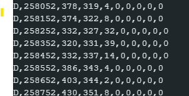
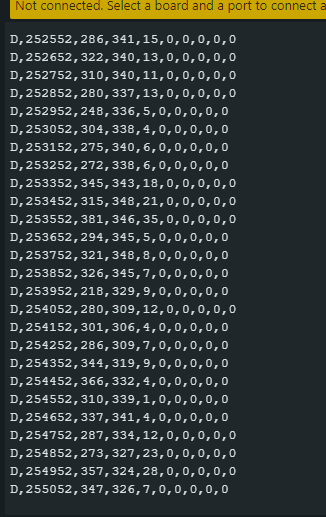
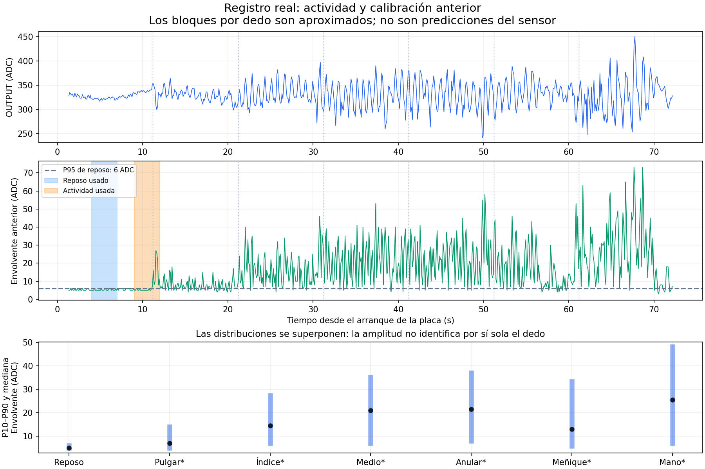

# Mediciones reales del AD8232 — 9 de noviembre de 2026

## Material conservado

| Ensayo | Datos | Resultado observado |
| --- | --- | --- |
| Reposo inicial | [CSV](reposo_46s/senal.csv), [eventos](reposo_46s/eventos.csv), [gráfica](reposo_46s/grafica.png) | 469 instantáneas en 46.8 s; 10 Hz; sin recorte, contacto perdido ni descartes observados |
| Reposo, dedos y mano completa | [CSV](reposo_dedos_mano_71s/senal.csv), [eventos](reposo_dedos_mano_71s/eventos.csv), [gráfica](reposo_dedos_mano_71s/grafica.png) | 709 instantáneas en 70.8 s; actividad variable y calibración rechazada |

Las fechas de recepción originales permanecen en `host_utc`. Los archivos se copiaron sin modificar; `sha256.json` permite verificar su integridad. Son capturas del firmware anterior a esta integración modular, no una prueba física del código posterior.

El segundo ensayo comenzó en reposo; después se movieron pulgar, índice, medio, anular y meñique, uno a uno, con aperturas/cierres repetidos de unos 10 s, y al final la mano completa. El operador no midió exactamente cada transición. Los límites de [bloques_estimados.csv](bloques_estimados.csv) son aproximados; no son etiquetas de clasificación validadas.

## Observaciones que justifican los cambios

En el reposo de 2–10 s, la envolvente anterior tiene mediana 5 y P95 de 6 cuentas ADC. La calibración midió reposo a los 4–7 s y actividad a los 9–12 s; el primer cambio visible aparece cerca de los 11 s. En esas ventanas las medias de telemetría son aproximadamente 5.3 y 8.17: la separación es menor que el mínimo anterior de 12. Las instantáneas no permiten reconstruir la media de todas las muestras internas.

Las distribuciones de los dedos se superponen; medio y anular presentan medianas aproximadas de 21 y 21.5. No basta una tabla de amplitudes para identificar cada dedo. Se eligió una orden común: actividad para cerrar, reposo para abrir.

Las capturas adicionales muestran envolventes de una cifra durante algunos intervalos y picos de 11–39 cuentas entre descensos. También muestran umbrales `0,0`: no había una calibración válida en esas tramas. Estos datos justifican una calibración explícita, umbrales al inicio de actividad y una decisión ponderada que no invierta la rampa por cada descenso breve. No prueban que todo movimiento pequeño tenga causa exclusivamente informática.

## Límites y validación pendiente

El CSV contiene instantáneas a 10 Hz de una adquisición interna a 1 kHz. No permite aplicar ni validar retrospectivamente filtros de 30, 60 o 200 Hz. Los filtros nuevos deben actuar sobre muestras internas y verificarse después en el montaje. No se afirma eliminación completa de ECG, reconocimiento de dedos ni fuerza/posición física medida. La validación posterior debe separar pruebas sintéticas y mediciones reales, repetir reposo/contracción y comprobar tiempos, colas, servos y alimentación.
